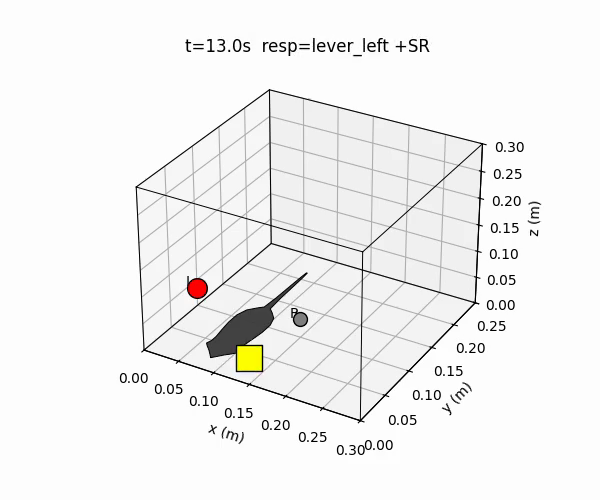

# result-chamber-animator

:jp: [日本語版 README](README.ja.md)

result-chamber-animator turns a recorded operant session into an animation of the chamber: the subject moves to the operandum (lever) it responded on at each step, and the food hopper lights up when the response was reinforced. It is meant for teaching and for presenting results, and it only replays data that were already recorded. In [OperantKit](https://github.com/OperantKit) it reads the session logs written by [session-recorder](https://github.com/OperantKit/session-recorder) as well as simple CSV and JSONL files.

- **One frame per recorded event by default.** Nothing is added unless you ask for it.
- **Synthesized frames are labeled as such.** The optional in-between frames follow published accounts of behavior between reinforcers and are marked as a model, not data.
- **PNG, GIF, or MP4.** A single step as an image, a GIF without extra software, or an MP4 when ffmpeg is installed.

Notes for AI coding agents are in [AGENTS.md](AGENTS.md).

<p align="center"></p>

## Installation

Python 3.11 or newer. result-chamber-animator is not on PyPI yet, so `pip install result-chamber-animator` does not work today. Install it from GitHub:

```bash
pip install git+https://github.com/OperantKit/result-chamber-animator
```

This is enough for CSV and JSONL input. To read OKL session logs as well, add session-recorder and the OperantKit packages it needs, without dependency resolution:

```bash
G=git+https://github.com/OperantKit
pip install --no-deps $G/contingency-dsl-py $G/contingency-py $G/experiment-core $G/session-recorder
```

MP4 output needs `ffmpeg` on `PATH`.

## Example

Turn a recorded session into an animated GIF:

```python
import matplotlib

matplotlib.use("Agg")  # headless

import pandas as pd

from result_chamber_animator import animate, steps_from_dataframe

# A recorded session: which operandum was pressed on each step and whether it was reinforced.
rows = pd.DataFrame(
    {
        "step": range(8),
        "chosen_response": ["lever_left", "lever_left", "lever_right", "lever_left",
                            "lever_right", "lever_right", "lever_left", "lever_right"],
        "is_reinforced": [False, True, False, False, False, True, True, False],
    }
)
frames = steps_from_dataframe(rows, dt=1.0)
print(len(frames), sum(f.is_reinforced for f in frames))  # 8 3
animate(frames, output_path="session.gif", fps=4)  # GIF needs no ffmpeg; use .mp4 when ffmpeg is installed
```

Each frame places the subject at the operandum pressed on that step, and on reinforced steps the hopper lights and the title shows `+SR`. The same rows saved as a CSV file give the same GIF from the command line: `result-chamber-animator session.csv --gif session.gif`.

## Usage

### Input

- **CSV or JSONL** (`.csv`, `.jsonl`, `.ndjson`) with the columns `step`, `chosen_response` (`lever_left` or `lever_right` in the default two-lever chamber), and `is_reinforced`.
- **OKL v1 session logs** (any other file whose first line is `# OKL v1`), with session-recorder installed. Each response is drawn at its operandum (0 = left lever, 1 = right lever; a log whose responses record no operandum is drawn in a chamber with one lever, key `lever`) and counts as reinforced when a reinforcer on the same operandum follows within 50 ms; reinforcer events put the subject at the hopper.

### Command line

```bash
# MP4 (requires ffmpeg on PATH)
result-chamber-animator session.csv --mp4 out.mp4 --fps 10

# GIF (no ffmpeg needed, larger file)
result-chamber-animator session.csv --gif out.gif --fps 5

# One step as a still image
result-chamber-animator session.csv --frame 42 --png frame42.png

# Rat or pigeon instead of the default sphere
result-chamber-animator session.csv --mp4 out.mp4 --subject rat

# Add synthesized frames between recorded events (see below)
result-chamber-animator session.csv --mp4 out.mp4 --subject rat --inter-event-behavior --fps 12
```

`result-chamber-animator --help` lists all options, including the window lengths and the random seed for the synthesized frames.

### Subjects

The chamber is drawn in 3D; the subject is a flat top-down figure on the chamber floor, turned to face the operandum it responds on.

| `--subject` | What is drawn |
|---|---|
| `sphere` (default) | A brown sphere: the subject as a position only |
| `rat` | Top-down rat silhouette: snout, ears, body, tail |
| `pigeon` | Top-down pigeon silhouette: beak, head, body, tail fan |

### Behavior between recorded events

With `--inter-event-behavior` (or `inject_inter_event_behavior=True` in `animate`), the renderer adds frames between recorded events and assigns each to one of three phases of behavior between reinforcers:

| Phase | When | Where the subject is drawn | Reference |
|---|---|---|---|
| **Adjunctive** | Within `adjunctive_window_s` after a reinforcer | At the food hopper | Falk (1961, 1971) |
| **Interim** | The middle of the gap | Walking along the chamber walls | Staddon & Simmelhag (1971); Timberlake & Lucas (1985) |
| **Terminal** | Within `terminal_window_s` before the next recorded response | Moving toward the operandum about to be pressed | Staddon & Simmelhag (1971) |

Where the two windows overlap, the adjunctive phase wins, so a short interval after a reinforcer is not labeled terminal. On these frames the figure also scales slightly in and out (about ±4%).

```python
animate(
    frames,
    inject_inter_event_behavior=True,  # off by default
    adjunctive_window_s=3.0,            # after a reinforcer: at the hopper
    terminal_window_s=1.5,              # before a response: approaching the operandum
    jitter_amplitude=0.005,             # max random offset, metres
    seed=0,                             # same seed, same frames
    fps=12,
    output_path="between.gif",
)
```

**The synthesized frames do not correspond to recorded events.** They are a model of the interval between events, not a replay of the data; the hopper lights only on recorded reinforced steps. Leave this option off whenever the animation must match the record one to one.

[`docs/examples/demo_session.py`](docs/examples/demo_session.py) writes two demo MP4s to `docs/assets/`: a rat with synthesized in-between frames at 12 fps, and a sphere with recorded steps only at 4 fps.

## Limitations

- Replays recorded data only; it does not run a session.
- Each recorded step or event is one frame; time between events is not drawn unless synthesized frames are turned on.
- The chamber is a plain box with two levers (or one) and a hopper, not a model of any manufacturer's apparatus.
- MP4 output needs `ffmpeg`.

## Development

```bash
python -m venv .venv
.venv/bin/python -m pip install -e ".[dev]"
.venv/bin/python -m pytest
```

Every `python` block in this README and `README.ja.md` is run by `tests/test_readme_examples.py`.

## References

- Falk, J. L. (1961). Production of polydipsia in normal rats by an intermittent food schedule. *Science*, *133*(3447), 195-196. https://doi.org/10.1126/science.133.3447.195
- Falk, J. L. (1971). The nature and determinants of adjunctive behavior. *Physiology & Behavior*, *6*(5), 577-588. https://doi.org/10.1016/0031-9384(71)90209-5
- Staddon, J. E. R., & Simmelhag, V. L. (1971). The "superstition" experiment: A reexamination of its implications for the principles of adaptive behavior. *Psychological Review*, *78*(1), 3-43. https://doi.org/10.1037/h0030305
- Timberlake, W., & Lucas, G. A. (1985). The basis of superstitious behavior: Chance contingency, stimulus substitution, or appetitive behavior? *Journal of the Experimental Analysis of Behavior*, *44*(3), 279-299. https://doi.org/10.1901/jeab.1985.44-279

## License

MIT (declared in `pyproject.toml`; the repository has no LICENSE file).
